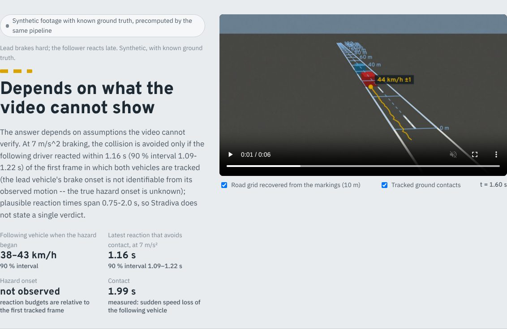
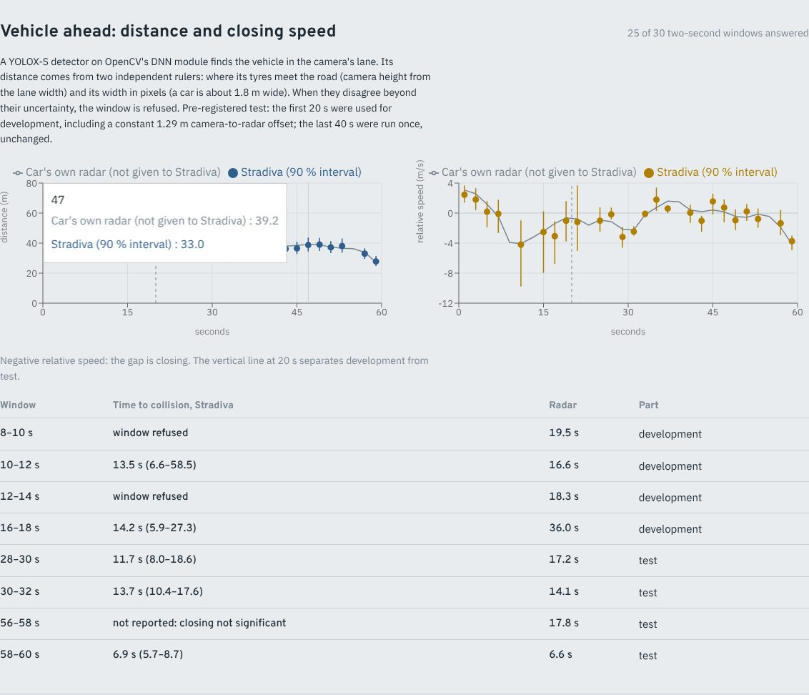
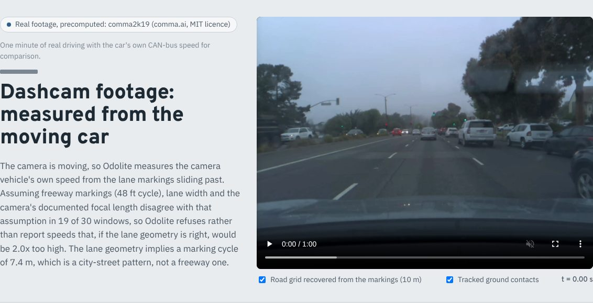
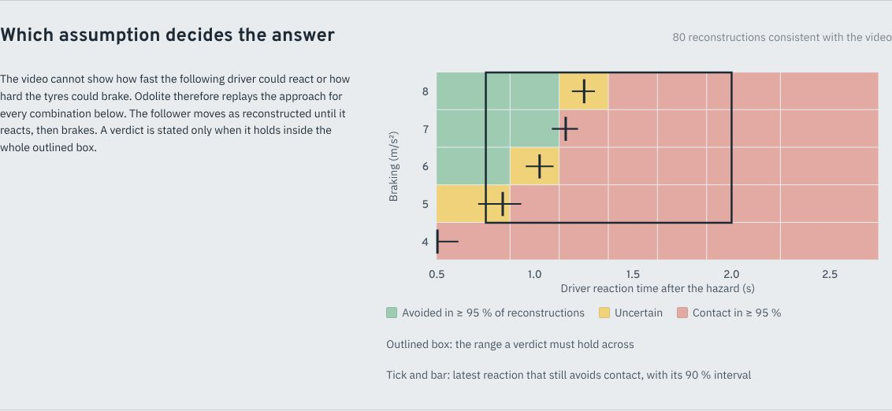
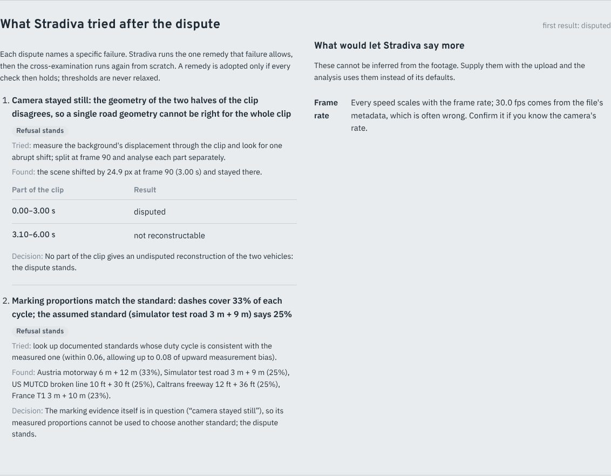
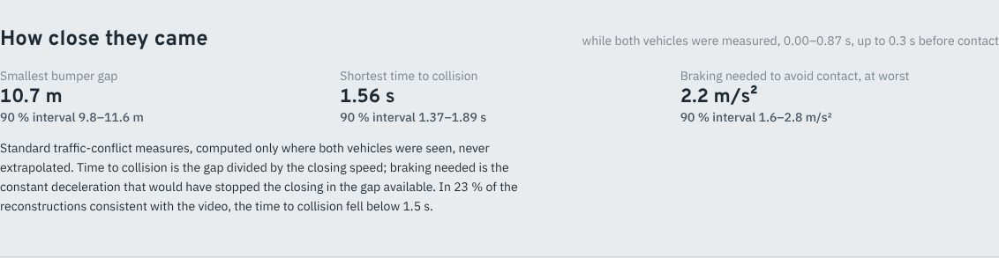
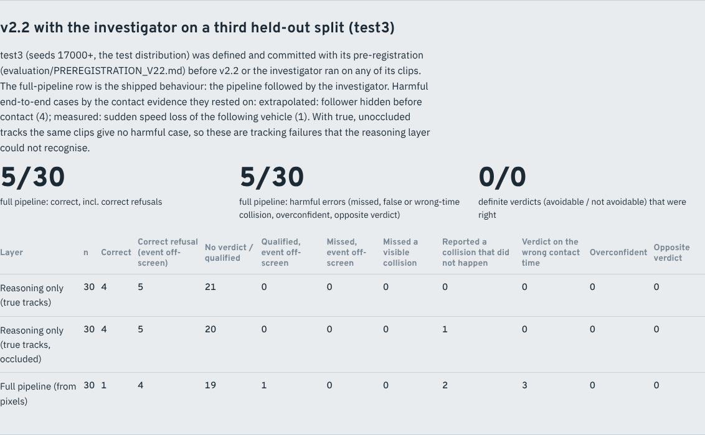
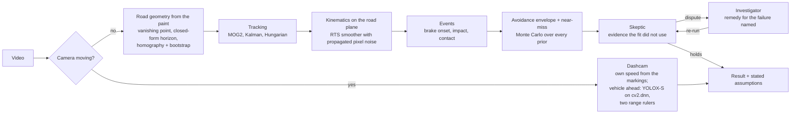

<div align="center">

# Stradiva

**Measurements from uncalibrated road footage, with every assumption stated.**

Speed, timing, near-misses and "could braking have prevented it?" from ordinary traffic and dashcam
video. The only ruler is the road's own paint. Stradiva never assigns fault, and it says *why* when the
footage cannot support a number.


**[Live demo: stradiva-liard.vercel.app](https://stradiva-liard.vercel.app)** · OpenCV AI Competition 2026 entry ·
[Technical report](docs/technical_report.md) ·
[How it was tested](docs/EVALUATION.md) · [Every number](docs/EVALUATION_RESULTS.md)



</div>

---

## What it does

| Footage | What Stradiva measures | How it knows the scale |
|---|---|---|
| **Fixed camera** (CCTV, traffic pole) | Speed of every tracked vehicle; the lead's brake onset; the moment of contact; smallest gap, time to collision and braking needed (near-miss measures); whether braking could have avoided contact, over a stated range of reaction times and braking capabilities | The dash cycle of the lane markings, through a homography recovered from the paint alone |
| **Dashcam** | The camera car's own speed; the distance, closing speed and time to collision of the vehicle ahead | The markings sliding past; two independent range rulers (the ground plane and the vehicle's width) |

Three things make it different from a speed estimator:

1. **Verdicts name the assumption that decides them.** Stradiva replays the approach for every reaction time
   from 0.75 to 2.0 s and every braking level from 5 to 8 m/s². It answers "avoidable" or "not avoidable"
   only when the answer holds across the whole range. Otherwise it reports the latest reaction that would
   still have avoided contact, with its interval.
2. **It cross-examines itself.** A separate set of checks tries to contradict each reconstruction with
   evidence the fit never used: markings predicted from each other, the geometry re-estimated on each
   half of the clip, the dash proportions against the assumed standard, vehicle widths, and physically
   possible motion. When a check blocks a result, the **investigator** runs the remedy for that specific
   failure, and the remedy's result must pass the whole cross-examination again.
3. **Refusal is a result.** "Not reconstructable", "contact not established" and "disputed" come with the
   reason, and with the input that would let it say more (frame rate, focal length, marking standard).

## Screenshots

<table>
<tr>
<td width="50%"><br><sub><b>Real dashcam footage.</b> The vehicle ahead, measured with YOLOX-S on OpenCV's DNN module, against the car's own radar (grey), which Stradiva never saw.</sub></td>
<td width="50%"><br><sub><b>Wrong assumption caught.</b> On the same real clip, lane width and focal length contradict a freeway marking standard, so Stradiva refuses instead of reporting speeds twice too high.</sub></td>
</tr>
<tr>
<td><br><sub><b>Which assumption decides the answer.</b> Where contact was avoided across reaction times and braking levels; the verdict must hold inside the outlined box.</sub></td>
<td><br><sub><b>After a dispute.</b> The camera was knocked mid-clip; Stradiva finds the bump, re-analyses each part, and reports that the refusal stands.</sub></td>
</tr>
<tr>
<td><br><sub><b>How close they came.</b> Smallest gap, time to collision and braking needed, each with a 90 % interval.</sub></td>
<td><br><sub><b>Held-out results, failures included.</b> Every number in the UI is generated from <code>evaluation/results/</code>.</sub></td>
</tr>
</table>

## How it works



**OpenCV 5 does every image operation:** `HoughLinesP` and `fitLine` for the markings, `remap` to sample
strips in inverse distance (dashes become exactly periodic), `createBackgroundSubtractorMOG2` and
`KalmanFilter` for tracking, `calcOpticalFlowPyrLK` and `findTransformECC` for camera motion,
`phaseCorrelate` for dashcam strips, `dnn.readNet` with YOLOX-S from the OpenCV Model Zoo for the vehicle
ahead. The road-plane geometry on top is our own NumPy code. Details: [architecture](docs/architecture.md)
and [technical report](docs/technical_report.md).

**AWS:** an API Gateway + Lambda issues presigned upload URLs; an S3 upload triggers a container-image
Lambda that runs the analysis; DynamoDB tracks the job; footage expires automatically after 7 days. One SAM
template ([`infrastructure/aws/template.yaml`](infrastructure/aws/template.yaml)), runbook and sizing in
[docs/aws.md](docs/aws.md).

## Results

All numbers are generated from committed result files by `evaluation/build_report.py`; the full tables
are in [docs/EVALUATION_RESULTS.md](docs/EVALUATION_RESULTS.md). Test sets were fixed in advance,
real-footage tests were pre-registered, and each held-out set was run once.

| What | Data | Result |
|---|---|---|
| Vehicle ahead: distance | Real dashcam (comma2k19), car's own radar as truth, pre-registered test part | **2.4 %** median error; the radar inside the 90 % interval in **17 of 17** answered windows |
| Vehicle ahead: closing speed | same | **0.58 m/s** median error; 82 % interval coverage; time to collision inside the interval **3 of 3** |
| Own speed, freeway | Real dashcam (comma.ai speedchallenge), pre-registered | 2.3 % median error, 90 % coverage |
| Own speed, city holdout | Real dashcam (comma2k19), pre-registered | **Failed**: wrong marking standard, speeds 2× too high. A second ruler added afterwards now refuses this case |
| Collision reasoning, true tracks | Simulator, held-out test3 | 9 / 30 correct, **0 harmful**; most others correctly decline |
| Collision reasoning, full pipeline from pixels | Simulator, held-out test3 | 5 / 30 correct, **5 harmful**, mainly contacts extrapolated while the follower was hidden |
| Road geometry | Simulator, same 18 scenes as the original code | 18 accepted with at most 0.23 % scale error (the original code accepted 4, with up to 9.3 % error) |

**What is not validated:** the collision verdicts have been tested on simulation only. We found no real
crash footage with ground truth that we could legally use. The near-miss measures are accurate with
true tracks but not yet reliable from pixels. On held-out data, the investigator changed no collision
outcome. Every limitation is listed in [the technical report, section 8](docs/technical_report.md#8-limitations).

## Quick start

```bash
git clone https://github.com/Abdullah49645/stradiva.git && cd stradiva
pip install -r requirements-dev.txt          # Python 3.12+; OpenCV 5 headless, NumPy, SciPy (pinned)
bash models/fetch_models.sh                  # YOLOX-S detector for the dashcam mode (SHA-256 checked)
python3 -m pytest -q tests                   # 35 tests: units, integration, investigator, AWS handlers (moto)
```

Analyse a clip from the command line (the same analysis the service runs):

```bash
python3 -c "from backend.investigator.investigator import investigate; import json; \
print(json.dumps(investigate('clip.mp4', user_inputs={'fps': 30}), indent=1)[:3000])"
```

Run the web UI with the local API (same job contract as the AWS deployment):

```bash
uvicorn backend.api.server:app --port 8000
cd frontend && npm ci && NEXT_PUBLIC_STRADIVA_API_BASE=http://localhost:8000 npm run dev   # http://localhost:3000
```

The UI ships with the bundled case files and works without the API; the API is needed only to analyse your
own clip. Optional inputs with an upload: frame rate, focal length in pixels, marking standard.

Deploy to AWS: `bash deploy/deploy_aws.sh` (AWS CLI logged in, SAM CLI, Docker running; see [docs/aws.md](docs/aws.md)).
Rebuild every evaluation number: [docs/EVALUATION.md §8](docs/EVALUATION.md#8-reproduce).

## Repository map

| Path | What |
|---|---|
| `backend/pipeline/analyze.py` | The pipeline: ingest, geometry, tracking, kinematics, events, envelope, near-miss, Skeptic |
| `backend/investigator/` | Remedies for blocking disputes, trace, requests for user inputs, input validation |
| `backend/geometry/`, `cv/geometry/` | Road geometry from markings; documented marking standards with sources |
| `cv/tracking/mot.py` | Background, foreground and multi-object tracking |
| `backend/reconstruction/`, `backend/causality/` | Smoothing, impact and brake-onset detection, avoidance envelope |
| `backend/verification/skeptic.py` | Cross-examination checks |
| `backend/dashcam/` | Own speed from markings; the vehicle ahead (`lead_vehicle.py`) |
| `cv/detection/dnn_detector.py`, `models/` | YOLOX-S on `cv2.dnn`; model download script |
| `backend/api/server.py`, `infrastructure/` | Local API; SAM template, Lambda handlers, Dockerfile |
| `evaluation/` | Simulator, test suites, real-footage runs and pre-registrations, results, report builder |
| `frontend/` | Next.js case viewer and evidence pages (static export) |
| `docs/` | Technical report, evaluation, architecture, AWS, assumptions, prior art, demo plan, licensing, data provenance |

Modules from the first version (`backend/agent`, `backend/api/process_video.py`, `backend/multiview`,
`backend/behavior` and others) are kept only for the before/after comparison in the evaluation.

## Responsible use

* **No fault.** Outputs describe motion and what braking could have achieved under stated assumptions.
* **Not for legal decisions on its own.** It is a research prototype whose collision verdicts are validated
  on simulation only; any legal or insurance use needs an expert who can examine the assumptions.
* **Assumptions travel with every result** ([docs/assumptions.md](docs/assumptions.md)).
* **Footage is private and short-lived:** presigned uploads, a private bucket, expiry after 7 days
  (results after 30).

## Licence, data and naming

Code: Apache-2.0 ([LICENSE](LICENSE), [NOTICE](NOTICE), [reasoning](docs/licensing.md)). Data and model
provenance: [docs/data_provenance.md](docs/data_provenance.md). One comma2k19 excerpt (MIT) is bundled;
the YOLOX-S model (Apache-2.0, OpenCV Model Zoo) is downloaded, not stored. All other footage is synthetic.

Stradiva was developed under the working name *CARAI*. Identifiers inside the frozen, pre-registered result
files (`carai_verdict`, pipeline versions `carai-2.x`, the default prior name `carai_synthetic_centerline`)
keep that name, so those files stay exactly as they were when the tests ran.

Author: [Abdullah49645](https://github.com/Abdullah49645)
