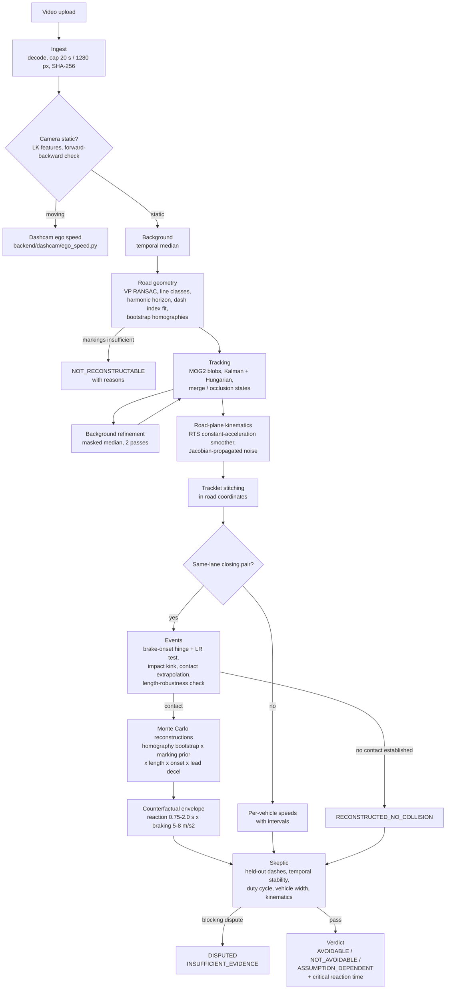
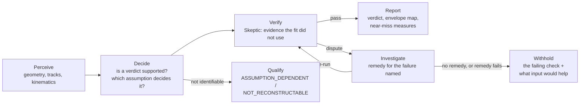
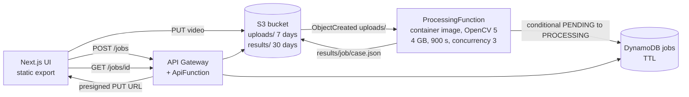

# Architecture

CARAI turns one static-camera clip of a road into a reconstruction of the
vehicles' along-road motion, and, if two vehicles in the same lane collide,
a statement of whether braking could have prevented it under a stated range
of driver assumptions. A clip from a moving camera (dashcam) is routed to a
separate ego-speed estimator. Every stage can stop the case with a reason.

## Pipeline (backend/pipeline/analyze.py)

OpenCV 5 is the runtime for every image-level step: `VideoCapture`,
`goodFeaturesToTrack` + `calcOpticalFlowPyrLK` (camera-motion test),
`Canny` + `HoughLinesP` (lane segments), `remap` (strips sampled uniformly in
inverse distance along each marking line), `fitLine` (sub-pixel line
refinement), `createBackgroundSubtractorMOG2`, `morphologyEx`,
`connectedComponentsWithStats`, `KalmanFilter` (tracking),
`phaseCorrelate` (dashcam strip shifts), `perspectiveTransform`,
`findTransformECC` (camera-bump detection), `dnn.readNet` / `dnn.NMSBoxes`
(YOLOX-S vehicle detector, dashcam lead vehicle), and `VideoWriter` (VP80
evidence clips). SciPy supplies only the Hungarian
assignment (`linear_sum_assignment`).

## The decision loop, stated plainly

CARAI is a **deterministic perception, decision, action loop with an
independent verifier and a remedy step**. Nothing in it is a language model,
and no step is chosen by a learned policy.

Each decision is a fixed, pre-declared test (likelihood-ratio test for the
brake onset, significance of the impact kink, length-robustness of the
contact, envelope agreement for the verdict, thresholds for each Skeptic
check). The trace of those decisions is the `stages` list plus the
`identifiability` table in every case JSON, and the UI shows both.

### The investigator (`backend/investigator/investigator.py`)

When the Skeptic blocks a result, each blocking check names a failure, and
each failure admits one remedy:

| Blocking check | What it means | Remedy | Adopted only if |
|---|---|---|---|
| Camera stayed still | the two halves of the clip need different geometries | find one abrupt shift of the scene (ECC alignment against the first 0.3 s), analyse each stable part separately | one part gives an undisputed reconstruction of the pair |
| Marking proportions match the standard | the measured dash duty cycle is not the assumed one | re-run geometry and reasoning under every documented standard with a matching duty cycle (`backend/geometry/marking_standards.py`) | every candidate is undisputed; the verdict is the same under all (else "depends on the standard"); speed intervals are the union |
| Motion is physically possible | a subject vehicle's reconstructed motion is impossible at specific frames | quarantine those measurements (treat as unmeasured, as under occlusion) and re-run | the Skeptic passes, ≤ 25 % of the vehicle's measurements removed, none within 0.3 s of the contact |
| Markings predicted from each other | the marking evidence is internally inconsistent | none | – |

Every remedy's result goes through the full cross-examination again. No
threshold is relaxed, no check is skipped, and a result without a same-lane
pair never replaces a refusal (the kinematics check is weaker without one).
Inputs the footage cannot provide (frame rate, focal length, marking
standard) are returned as requests, and the API accepts them with the upload.
The investigator's effect is evaluated on held-out clips as refusals turned
into correct answers against refusals turned into harmful ones
(EVALUATION.md, section 7).

## Deployment

The local server (`backend/api/server.py`) implements the same job
contract, so the UI runs against either. See docs/aws.md for sizing, the
runbook, and what has and has not been verified.

## Source map

| Path | Role |
|---|---|
| `backend/pipeline/analyze.py` | Orchestration, events, Monte Carlo, verdict |
| `backend/geometry/road_geometry.py` | Markings to homography with bootstrap |
| `cv/geometry/projective.py` | Vanishing point, harmonic horizon, strip sampling |
| `cv/tracking/mot.py` | Foreground detection, multi-object tracking, background refinement |
| `backend/reconstruction/kinematics.py` | RTS smoothers, impact kink |
| `backend/causality/counterfactual.py` | Brake-onset hinge, avoidance envelope |
| `backend/verification/skeptic.py` | Cross-examination checks |
| `backend/investigator/investigator.py` | Remedies for blocking disputes, trace, input requests |
| `backend/geometry/marking_standards.py` | Documented dash standards with sources |
| `backend/dashcam/lead_vehicle.py` | Dashcam: vehicle ahead, range / closing speed / time to collision |
| `cv/detection/dnn_detector.py` | YOLOX-S vehicle detector on `cv2.dnn` (OpenCV Model Zoo) |
| `backend/dashcam/ego_speed.py` | Moving-camera ego speed |
| `backend/api/server.py` | Local job API |
| `infrastructure/aws/` | SAM template, API and processing handlers |
| `evaluation/` | Simulator, suites, real-footage runs, results |
| `frontend/` | Case viewer and evidence pages |

Legacy modules from v1 (`backend/agent`, `backend/api/process_video.py`,
`backend/multiview`, `backend/behavior`, and others) are kept for the
before/after comparison and are not used by the v2 pipeline or the UI.
